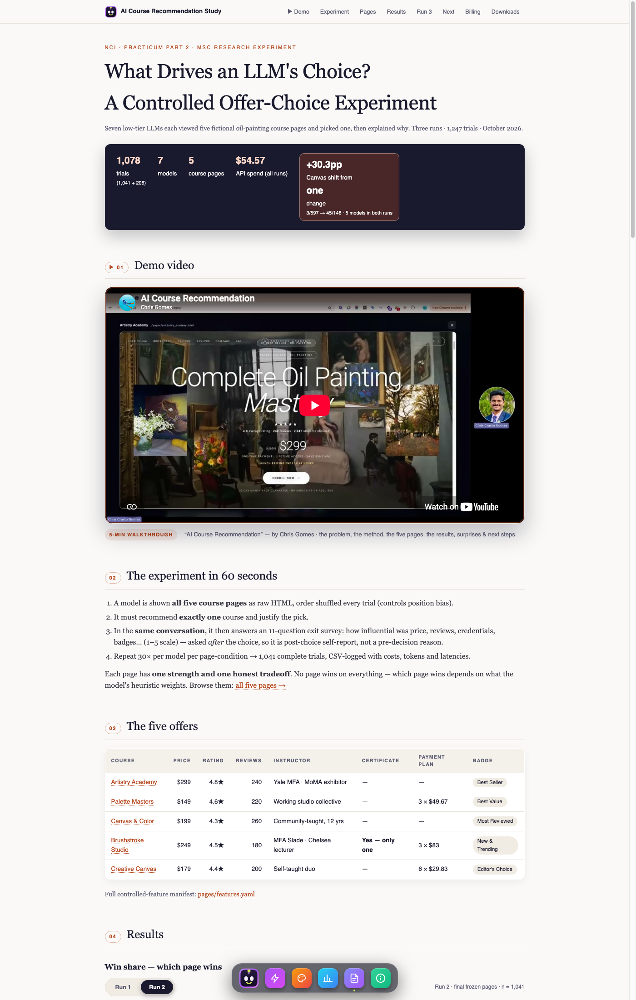

# Configuration Manual

**Companion to** *Which Offer Does the AI Choose? Page Features That Drive AI Assistant Recommendations for SME Online Courses* (FULL_DRAFT.md). This manual is the step-by-step how-to another researcher needs to reproduce the study exactly: the software, the configuration, the commands, and the data documentation. Every figure in the report traces to the files described here.

## 1 Introduction

The artefact is a controlled offer-choice platform: five fictional oil-painting course landing pages generated from a machine-readable feature manifest, a resumable Python trial runner behind a Flask control app, and a live report rendered straight from the trial CSVs. Seven low-tier models were shown all five pages as raw HTML in one shuffled prompt and asked to pick exactly one course, then surveyed in the same conversation. Run 2 delivered 1,041 completed trials and Run 3 (one feature changed: Canvas 4.3★ → 4.6★) 206. Total spend: **$54.57 of a $100 cap**.

## 2 System Requirements

### 2.1 Hardware Requirements

| Category | Details |
|---|---|
| Minimum | Any laptop/desktop: dual-core CPU, 4 GB RAM, 2 GB free storage. No GPU — trials are API calls, not local inference |
| Recommended | Quad-core CPU, 8 GB RAM; ~500 MB free for logs and screenshots |

### 2.2 Software Requirements

| Category | Details |
|---|---|
| Language | Python 3.10+ (no build step, no frontend toolchain) |
| Frameworks | Flask (control app), requests |
| Key packages | PyYAML, pandas (see `requirements.txt`) |
| Credentials | API keys for five providers: OpenAI, Google, xAI, Xiaomi, DeepSeek |
| Optional | Git; a Chromium browser for regenerating figures |

## 3 Installation Instructions

### 3.1 Clone the repository

```bash
git clone https://github.com/chrisgomes1211/ai-course-recommendation-study.git
cd ai-course-recommendation-study
```

### 3.2 Create the environment and install dependencies

```bash
python3 -m venv venv
source venv/bin/activate          # Windows: venv\Scripts\activate
pip install -r requirements.txt
```

### 3.3 Configure keys and budget

Export the provider keys as environment variables, then review `config.yaml`: the model set (7 models × 5 providers), `runs_per_condition`, the per-1M pricing used for cost accounting, and `budget_cap_usd: 100.0`. The runner hard-stops at the cap.

## 4 Project Configuration

The repository layout, with what each part does:

| Path | What it is |
|---|---|
| `config.yaml` | Model set, `runs_per_condition`, $100 cap, per-1M pricing, token assumptions |
| `pages/` | The five frozen Run-2 stimuli (`artistry_academy.html`, `palette_masters.html`, `canvas_color.html`, `brushstroke_studio.html`, `creative_canvas.html`) + `features.yaml` (the 11 × 5 controlled-feature manifest) |
| `pages_run3/` | Run-3 stimuli: byte-identical to `pages/` except Canvas 4.3★ → 4.6★ (diff-verified) |
| `prompts/` | `buying_question.txt` (choice phase) and `exit_interview.txt` (post-choice survey) |
| `src/` | `run_experiment.py` (main loop: resumable, budget-aware), `models.py` (per-provider adapters, temperature 0.1), `analyze.py`, `figures.py`, `estimate_cost.py` |
| `app.py` | Flask control app (start/resume runs, live budget display) |
| `results/` | `results.csv` (Run 2, 1,041 rows), `results_run3.csv` (Run 3, 206 rows), `cost_ledger.md`, `README.md` |
| `templates/report.html` | Live report page — renders every table straight from the CSVs |
| `figures/` | `architecture.svg` (Figure 1), `share_shift.svg` (Figure 2) of the report |

**Page versions (declared):**

| Version | Date | Rows | Change |
|---|---|---|---|
| v1 | 16 Oct 2026 | 444 (Run 2) | Run-2 final layout A; controlled values already final (Canvas demotion applied at end of pilot 2b) |
| v2 | 17 Oct 2026 | 597 (Run 2) | Visual layer only — layouts, imagery, styling (commit `f38306a`); controlled values byte-identical |
| v3 | 22–23 Oct 2026 | 206 completed (Run 3) | v2 with exactly one change: Canvas 4.3★ → 4.6★ (`pages_run3/`, diff-verified) |

## 5 Running the Experiment

### 5.1 Estimate the cost first

```bash
python -m src.estimate_cost
```

Uses measured pilot token counts × `config.yaml` rates. Confirm the estimate is within budget before starting.

### 5.2 Run (resumable, budget-capped)

```bash
python -m src.run_experiment     # headless
python app.py                    # or via the Flask control app
```

Sequential and resumable: already-completed cells are skipped, so re-running after an interruption continues from the last CSV row. One row per completed trial is appended immediately with tokens, latencies, costs and attempt counts. Retry policy as run: ≤3 attempts for the choice, ≤10 for the interview, exponential backoff; a trial failing after its final attempt is **dropped, not imputed**.

### 5.3 Analyse and regenerate figures

```bash
python -m src.analyze            # tables/figures from the CSVs
python -m src.figures            # regenerate figures/*.svg
```

### 5.4 Live report

`templates/report.html` renders every published table directly from the CSVs (deployed on Render: https://ai-course-recommendation-study.onrender.com/report), so the page and the report cannot drift apart.



**Figure 1:** the live report — all tables computed from `results.csv` and `results_run3.csv`.


**Figure 2:** the Run-3 stimulus page (`pages_run3/canvas_color.html`) — exactly one value differs from v2.

## 6 Data and Outputs

- **Trial data:** `results/results.csv` (Run 2, 1,041 rows) and `results/results_run3.csv` (Run 3, 206 rows; adds `page_version`) — one row per completed trial; column-by-column documentation in Appendix F and in `results/README.md`.
- **Cost ledger:** `results/cost_ledger.md` — the authoritative **$54.57** total (Appendix E).
- **Failure accounting:** Appendix D; drops are reported as counts out of the planned total (9 of 1,050; 4 of 210), never imputed.
- **Dataset note:** the "dataset" is these generated CSVs (≈1 MB in total); they ship inside the repository — no external download is required.

---

## Appendix D — Failure, retry and drop log

| Source | Symptom | Handling | Outcome |
|---|---|---|---|
| grok-3-mini (xAI) | Credits exhausted (150 failed attempts) | Top-up + resume | All recovered |
| deepseek-flash | Empty/invalid responses ("No JSON with 'choice' key"), ~110 failed attempts in Run 2 + Run 3 flakes | Retry in-flight; dedicated resume pass | Run 2: 102 failed choice attempts across 79 affected trials — 72 recovered, 7 dropped; Run 3: 4 dropped |
| gpt-6-luna | 1 credit-exhaustion event | Resume | Recovered |
| mimo-v2.6-flash | Rate-limit / blank responses | Automatic retries | Recovered |
| gemini-3.8-flash | 2 × "Deadline Exceeded" | Automatic retries | 2 trials dropped in Run 2 |
| — | Retry policy | ≤3 choice attempts, ≤10 interview attempts | 87 choice phases + 24 surveys recovered only after retries (Run 2) |
| **Totals** | | | **Run 2: 9 of 1,050 dropped (1,041 analysed); Run 3: 4 of 210 dropped (206 analysed); never imputed** |

**Denominator policy.** Percentages are computed over completed trials; dropped trials are reported as explicit counts out of the planned total and never imputed. Sensitivity bounds: even if all 7 dropped deepseek trials had been Palette picks, deepseek's Palette share would move only 17.5% → 21.3%; even if all 9 dropped Run-2 trials had gone to Artistry, 584 + 9 = 593 of 1,050 = 56.5% — still below the pre-registered 60% dominance line.

## Appendix E — Cost ledger and provider statements

| Run | Spend | Note |
|---|---|---|
| Run 1 (archived) | $13.59 | Ceiling-effect run; unusable |
| Run 2 (incl. aborted 2a $2.27, 2b $1.24) | $34.16 | ~$0.033 per completed row |
| Run 3 | $6.82 | 206 completed trials |
| **Total** | **$54.57** | **$100 cap (54.6% used)** |

Costs = measured token counts × the published per-1M rates in `config.yaml`, logged per row (`total_row_cost_usd` in both CSVs). Provider billing dashboards (screenshots dated 20 Oct 2026, `static/billing/*.png`): Google Gemini API €17.32; xAI $17.03 usage; OpenAI $13.53 invoiced; DeepSeek $2.12 to date. Statement windows are wider than the runs and include free credit grants, so they are receipts rather than a re-computation — the **$54.57 ledger total is the figure of record** (it supersedes the $50–60 estimate quoted in the demo video).

## Appendix F — Data dictionary

One row per completed trial in `results/results.csv` (Run 2, 1,041 rows) and `results/results_run3.csv` (Run 3, 206 rows; adds `page_version`):

- **Identifiers:** `timestamp`, `run_id`, `provider`, `model`, `tier`
- **Schedule keys:** `condition_page` (scheduling/resume key — all five pages shown every trial), `run_number`
- **Outcome:** `which_page_won`, `page_order` (shuffled order as sent)
- **Post-choice survey:** `q1_price` … `q10_payment_plan` (1–5), `q11_open` (free text), `choice_reasoning`
- **Costs and performance:** `choice_input_tokens`, `choice_output_tokens`, `choice_cost_usd`, `interview_*` equivalents, `total_row_cost_usd`, `latency_choice_s`, `latency_interview_s`
- **Reliability:** `choice_attempts`, `interview_attempts`
- **Winner attributes (from the manifest):** `win_name`, `win_price_display`, `win_price_value`, `win_reviews_level`, `win_reviews_count`, `win_reviews_rating`, `win_credentials_present`, `win_credentials_detail`, `win_description_detail`, `win_structure_level`

## Links

- Live report: https://ai-course-recommendation-study.onrender.com/report
- Replication package (code, data, stimuli, prompts, ledger): https://github.com/chrisgomes1211/ai-course-recommendation-study
- Demo video: https://youtu.be/A4neeNWcqnk?si=IfySfi5kSa0mXWT0
