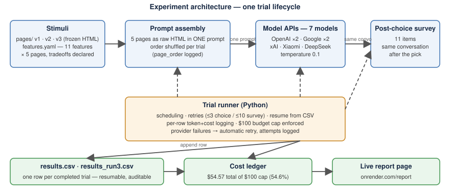

# 4. Design and implementation

The artefact under evaluation is a controlled offer-choice platform: five course pages
generated from a declared feature manifest, a resumable trial runner behind a Flask control
app, and a live report rendered straight from the trial CSVs. Figure 1 shows the lifecycle of
a single trial.

**Figure 1.** One trial flows from the frozen stimuli through prompt assembly (five pages as
raw HTML in one prompt, order shuffled) to the model APIs and the post-choice survey; the
trial runner controls retries, resume and the budget cap, and appends every completed trial
to the CSVs that feed the cost ledger and the live report.

## 4.1 Components

- **Stimuli.** Five oil-painting course pages as standalone HTML (`pages/`), generated from
  a single machine-readable manifest (`pages/features.yaml`: 11 features × 5 pages with
  declared tradeoffs), plus `pages_run3/` — the same five pages with exactly one value
  changed (Canvas 4.3★ → 4.6★), diff-verified byte-identical everywhere else. Page versions
  are frozen and declared (§5.2): v1 (16 Oct), v2 (frozen 17 Oct), v3 (Run 3 only).
- **Runner and app.** A Flask app (`app.py`) fronts a Python runner
  (`src/run_experiment.py`) that schedules the model × trial cells, assembles each prompt
  from `prompts/buying_question.txt` and `prompts/exit_interview.txt`, and enforces the
  retry policy — ≤3 choice attempts, ≤10 survey attempts, exponential backoff on transient
  provider errors (§5.3). Every completed trial is appended to CSV immediately, so an
  interrupted run resumes from the last row without repeating cells. That resumable CSV is
  what makes the drop accounting auditable: 9 of 1,050 in Run 2 and 4 of 210 in Run 3, each
  row's attempts visible in the data (§5.5).
- **Budget cap.** Per-row cost is computed from measured tokens × the published per-1M
  rates in `config.yaml` and checked against a **$100 hard cap**; actual spend was $54.57
  across all runs (§5.6).
- **Report.** `templates/report.html`, served on Render, renders every table in this report
  directly from the CSVs, so the published page and this document cannot drift apart.

## 4.2 Why raw HTML in one prompt

Three candidate interfaces were considered. **Screenshots** would force models to read exact
values (4.3★, $149, 260 reviews) from pixels — perception noise the design cannot afford,
because the experiment depends on every model seeing byte-identical data values. **A
browsing agent** would add multi-turn tool use: which elements it inspects, in what order,
becomes uncontrolled variance entangled with navigation behaviour, at several times the cost
per trial. **Raw HTML in a single prompt** (chosen) gives every model the same markup with
exact values in one turn, page order shuffled and logged per trial; the prompt *is* the
stimulus, so any trial can be replayed from its CSV row alone.

The declared trade-off: models see structural markup (headings, classes) that a human
reader does not. That exposure is constant across all five pages, both runs and all seven
models, so it cannot confound the between-page comparisons this report rests on. Whether
the findings transfer to screenshot-based or agentic settings is an external-validity
question, carried into §8.
