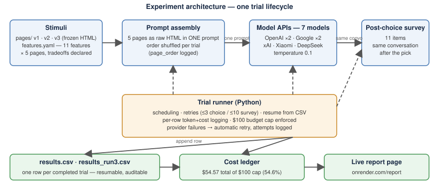
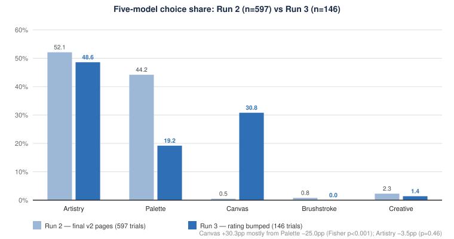

# Which Offer Does the AI Choose? Page Features That Drive AI Assistant Recommendations for SME Online Courses

**Chris Crasto Gomes** — AI for Business, Practicum Part 2

---

# 1. Abstract

Large language models are increasingly asked to choose on people's behalf — which course to take, which product to buy — yet what drives those choices is poorly understood. This study asks whether the conversion levers that move human buyers (review volume, ratings, credentials, price framing, social proof) move low-tier LLMs the same way, and whether stated reasons match choices. Seven low-tier models from five providers picked one of five controlled oil-painting course pages, served as raw HTML in one shuffled prompt, then answering an 11-item post-choice survey. Run 2 delivered 1,041 completed trials (597 on the final frozen pages) at temperature 0.1; Run 3 (206 trials) changed exactly one feature — the weakest page's star rating, 4.3★ → 4.6★. No page reached the pre-registered 60% dominance threshold: the balance arises from models disagreeing (three credentials-first, three price-first, one heterogeneous), not within-model uncertainty; stated drivers align with choices — consistency, not cause. For the five models in both runs, Canvas rose from 3 of 597 (0.5%) to 45 of 146 (30.8%) — support for H1: rating was the binding constraint for the middle of the field; the volume-heavy bundle competes only once its rating is not the lowest. The two models that saw only the earlier page version are reported separately (Canvas 10 of 60). A declared page-version change, drop counts and a $54.57 cost ledger accompany the results.

---

# 2. Introduction & research question

## 2.1 Why study how LLMs choose

Language models no longer only answer questions; they increasingly act on recommendations. An assistant asked "which course should I take?" makes a *choice* that functions as a recommendation: consistent LLM preference is inherited by users and downstream systems. What drives such choices — and whether explanations are trustworthy — is therefore a practical, not only academic, question.

## 2.2 The human levers this study puts to the test

Human buyers lean on a small set of cues: inferring quality from price (Rao and Monroe, 1989), following the crowd through review counts and enrolment numbers (Cialdini, 2001), deferring to authority in credentials, and responding to anchoring and installment framing (Tversky and Kahneman, 1974; Simonson and Tversky, 1992). Course landing pages are built from exactly these levers; trained on the same corpus, LLM recommenders should be moved by them too — though a model reading raw HTML may weigh them differently than a human skimming a page.

## 2.3 Why behaviour first, explanations second

A natural shortcut would be to simply ask models why — but language models do not
reliably report the factors that drove their outputs (Turpin et al., 2023), and an
explanation produced after a decision may rationalise it rather than reveal it. This study
therefore treats *choice* as the primary data and the model's own account as a
post-decision document, analysed for consistency with behaviour, never as evidence of
cause.

## 2.4 What is already known, and the gap

LLMs' choice behaviour has begun to attract direct study: Wu et al. (2025) find choices shaped by
attention bias and social influence with Matthew-effect and conformity patterns; Sfeir et al. (2026) find
LLMs capable of sound choice specifications under structured prompting while weaker models
struggle; and choices are presentation- and order-sensitive (Lu et al., 2022) — hence order
is shuffled and logged here. What is missing is a **feature-controlled offer-choice
experiment**: every competitive variable declared in advance, inexpensive models deployed
at scale, and a follow-up manipulating one feature rather than the whole page — this study
supplies all three.

## 2.5 Research question and expectations

> **RQ:** How do low-tier LLMs distribute choices across controlled offers, and do their choices track their stated reasons?

This is the research question approved for this programme on 1 October — *which page features most influence which offer the assistant recommends* when a learner compares SME online courses — restated in its general form; the results answer the applied form directly: **rating, credentials and price** are the features that move the assistant's recommendation.

Two competing expectations frame the follow-up: **H1** — if star rating was the binding
constraint in Run 2, lifting the weakest page's rating off the floor moves its share
materially above its same-pages baseline; **H2** — if the *bundle* on that page (most
reviews, lowest rating, no credentials) held it down, its share stays low.

## 2.6 Contributions

1. A five-way controlled offer-choice design — every feature in a machine-readable
   manifest — across seven low-tier models at near-deterministic temperature.
2. Stable per-model *heuristic signatures* (credentials-first, price-first, heterogeneous)
   that account for the aggregate balance.
3. A single-variable follow-up (4.3★ → 4.6★) whose like-for-like result — Canvas 3 of 597 →
   45 of 146 — supports H1 without overclaiming.
4. A full replication package: raw CSVs, stimuli, prompts, ledger and live report page.

**Roadmap.** Section 3 situates the study; Section 4 the artefact; Section 5 the Method; Section 6 results; Section 7 discussion; Section 8 threats; Section 9 conclusions; appendices carry supporting data.

---

# 3. Background / related work

## 3.1 Heuristics and cues in human choice

Decades of behavioural research show human choice runs on heuristics rather than full evaluation (Tversky and Kahneman, 1974; Kahneman, 2011); three families matter here. First, **price as a quality signal**: buyers infer quality from price when other information is scarce, and price framing shifts perceived quality independently of the product (Rao and Monroe, 1989). Second, **social proof**: review counts, enrolment totals and "students viewing now" bands are crowd cues that substitute for direct evidence (Cialdini, 2001). Third, **context and contrast**: offers are not judged in isolation — tradeoff contrast and extremity aversion make the *composition* of the choice set part of the judgment (Simonson and Tversky, 1992) — hence all five pages appear together. Authority cues (credentials) and anchoring complete the toolkit this study varies per page.

## 3.2 LLMs as choosers

The nearest work is Wu et al. (2025), probing LLM choice behaviour on a virtual platform: choices shaped by attention bias and social influence, with Matthew-effect and conformity patterns. Sfeir et al. (2026) approach from econometrics, testing whether LLMs can assist *analysts* in building choice specifications rather than making choices themselves; capable models produce behaviourally sound specifications under structured prompting, open-weight models often not. Because that task is analyst assistance, not offer choice, it supports the low-tier focus only indirectly. The higher bands remain under-criticised: studies reporting strong frontier-model choice rarely hold the stimulus constant or separate presentation from data values, so cross-tier disagreement may be methodological rather than substantive. Recommendation itself is increasingly built on generative models, now surveyed as Gen-RecSys (Deldjoo et al., 2024), yet those systems are judged on ranking metrics over logged interactions rather than a controlled side-by-side offer choice. This study fills that gap at the low tier — inexpensive models deployed at scale, a declared feature matrix, a single-variable follow-up.

Adjacent is the practitioner literature on *influencing* LLM output: Aggarwal et al. (2024) formalise Generative Engine Optimization — black-box methods for improving a source's visibility in generated answers — and Kumar and Lakkaraju (2024) show that a strategic text sequence on a product page significantly raises its chance of being the LLM's top recommendation. Both optimise from the content side, but neither identifies *which* page features move a choice when options sit side by side with every other feature declared — this study's question.

Two methodological findings bear on design. **Presentation matters**: the same options in a
different order change outputs (Lu et al., 2022); positional effects run deep — relevant
information degrades when it sits mid-context (Liu et al., 2024), option order alone can flip
an LLM's ranking of two answers (Wang et al., 2024), and semantically identical prompt
formats move accuracy by tens of points (Sclar et al., 2024) — hence order is shuffled and
logged per trial (`page_order`) and every model sees byte-identical markup. **Population
matters**: models within a family disagree, so results are reported per model, pooled only
with counts attached.

## 3.3 Explanation versus behaviour

Turpin et al. (2023) show that chain-of-thought explanations can systematically misdescribe what drove a model's answer — the explanation is generated, not read out of the decision. Post-choice ratings here are therefore analysed as **consistency between stated and revealed preference** (§6.4), never as evidence that a rated factor *caused* the choice. Where this report says a factor was "the binding constraint", the claim rests on the *behavioural* comparison in §6.5 — same models, same pages, one feature changed — not on what the models said.

## 3.4 Where this study fits

Compared with Wu et al. (2025), it holds the stimulus constant and manipulates one feature in
follow-up; with Sfeir et al. (2026), it measures choices rather than specifications; with the
prompt-sensitivity literature, order is a logged nuisance. Its distinctive
combination: a declared feature matrix, seven low-tier models, near-deterministic
sampling, a pre-stated single-variable test, and a replication package with per-row
costs.

---

# 4. Design and implementation

The artefact under evaluation is a controlled offer-choice platform: five course pages generated from a declared feature manifest, a resumable trial runner behind a Flask control app, and a live report rendered straight from the trial CSVs (Figure 1).

**Figure 1.** One trial flows from frozen stimuli through prompt assembly (five pages as
raw HTML, order shuffled) to the model APIs and the survey; the runner controls retries,
resume and the budget cap, appending each trial to the CSVs behind the cost ledger and
live report.

## 4.1 Components

- **Stimuli.** Five oil-painting course pages as standalone HTML (`pages/`) from
  one manifest (`features.yaml`: 11 features × 5 pages, declared tradeoffs), plus
  `pages_run3/` — same five pages, one value changed (Canvas 4.3★ → 4.6★), diff-verified
  byte-identical elsewhere; versions frozen and declared (§5.2): v1 (16 Oct), v2 (frozen
  17 Oct), v3 (Run 3 only).
- **Runner and app.** A Flask app (`app.py`) fronts a Python runner
  (`src/run_experiment.py`) that schedules the model × trial cells, assembles prompts from
  `prompts/`, and enforces the retry policy — ≤3 choice attempts, ≤10 survey attempts,
  exponential backoff on transient provider errors (§5.3). Every completed trial appends to
  CSV immediately, so an interrupted run resumes from the last row; the CSV makes drop
  accounting auditable (9 of 1,050, 4 of 210, attempts per row, §5.5).
- **Budget cap.** Per-row cost = measured tokens × per-1M rates (`config.yaml`), checked
  against a **$100 hard cap**; actual spend $54.57 across all runs (§5.6).
- **Report.** `templates/report.html` on Render renders every table here straight from
  the CSVs, so page and document cannot drift apart.

## 4.2 Why raw HTML in one prompt

Three candidate interfaces were considered. **Screenshots** would force models to read exact
values (4.3★, $149, 260 reviews) from pixels — perception noise the design cannot afford.
**A browsing agent** would add multi-turn tool use — which elements it inspects and in what
order becomes uncontrolled variance entangled with navigation, at several times the cost.
**Raw HTML in a single prompt** (chosen) gives every model the same markup with exact values
in one turn, order shuffled and logged; the prompt *is* the stimulus, replayable from
its CSV row alone.

The declared trade-off: models see structural markup a human does not — constant across
pages, runs and models, so it cannot confound the between-page comparisons; transfer to
screenshot or agentic settings is an external-validity question (§8).

---

# 5. Method

This section describes the experiment as run: stimuli, page-version history (the mid-run
change declared in full), procedure, model set, failures and cost. Every figure traces to
the code (`src/`), manifest (`pages/features.yaml`), `config.yaml`, trial CSVs and cost
ledger (`results/cost_ledger.md`).

## 5.1 Stimuli and the controlled-feature design

The stimuli are **five fictional oil-painting course landing pages** (`pages/*.html`),
served to the models as **raw HTML** (no rendering, no JavaScript). Each instantiates a
distinct offer profile from a controlled feature matrix (`pages/features.yaml`) — eleven
features per page (Table 1).

Design principle (set after two aborted pilots, §5.2): **each page gets one strength and
one honest tradeoff** — ratings 4.3–4.8★, reviews in a 180–260 ladder, one certificate only,
and the five newer signals (badge, social proof, comparison table, anchoring, installments)
spread rather than stacked. The five profiles as run:

**Table 1:** The five offer profiles as run — eleven controlled features across five pages (source: `pages/features.yaml`).

| Feature | Artistry Academy | Palette Masters | Canvas & Color | Brushstroke Studio | Creative Canvas |
|---|---|---|---|---|---|
| Price | $299 (anchored from $349) | **$149** (lowest) | $199 | $249 (anchored from $299) | $179 (6 × $29.83) |
| Reviews | 240 · 4.8★ | 220 · 4.6★ | **260 (most) · 4.3★ (lowest)** | **180 (fewest)** · 4.5★ | 200 · 4.4★ |
| Credentials | Yale MFA, MoMA exhibitor | none (studio collective) | none (community-taught, 12 yrs) | MFA Slade, former Chelsea lecturer | none (self-taught duo) |
| Certificate | no | no | no | **yes (only one)** | no |
| Lessons | 96 | 72 | 64 | 80 | **58 (fewest)** |
| Badge | Best Seller | Best Value | Most Reviewed | New & Trending | Editor's Choice |
| Enrollment social proof | 2,847 enrolled | 4,120 enrolled | **6,340 (largest community)** | **410 (smallest)** | 1,560 enrolled |
| Comparison table | yes | yes | no | yes | no |
| Price anchoring | yes ($349 → $299) | no | no | yes ($299 → $249) | no |
| Payment plan | no | 3 × $49.67 | no | 3 × $83 | 6 × $29.83 |
| Stated tradeoff | Priciest; no certificate | No certificate, no credentialed instructor | Lowest rating; no credentials/certificate/installments | Fewest reviews; second-highest price | Lowest rating; fewest lessons |

**All five pages appear in every trial** — a five-way forced choice, not pairwise
comparisons; page order is shuffled every trial and recorded (`page_order`), so order
effects are auditable.

## 5.2 Page-version history (declared)

Three page versions exist; the boundary falls inside Run 2, declared here rather than
buried:

- **v1 — trials of 16 Oct 2026 (444 rows).** Run-2 final layout A; controlled values already
  final (the Canvas demotion — 260 reviews @ 4.3★, community-taught, no credentials — was
  applied at the end of **pilot 2b, before any Run-2 trial**).
- **v2 — trials of 17 Oct 2026 (597 rows), frozen thereafter.** A **visual-layer-only**
  update: layouts, imagery and per-page styling changed (commit `f38306a`); the controlled
  data values did not. Verified two ways from the trial records: (1) every winner attribute
  is byte-identical across the boundary (Artistry 240 · 4.8★ and credentials identical
  both dates; Palette 220 · 4.6★); (2) v1 reasoning quotes the final values ("260 reviews" in 52
  of 444 reasonings, "4.3" in 113) while pre-rebalance values ("15 reviews", "4.0")
  appear in **zero**.
- **v3 — Run 3, 22–23 Oct 2026 (210 planned / 206 completed).** v2 with exactly one change:
  Canvas's star rating 4.3★ → 4.6★. Everything else, and the other four pages, are
  byte-identical to v2 (diff-verified, `pages_run3/`).

Because models ran on both versions inside Run 2, stimulus version is a potential confound
for between-model comparisons: gemini-lite and mimo ran **v1 only** (150 each), gpt-4.1-mini
and grok **v2 only** (150 each), and deepseek (71/72), luna (32/118) and gemini-3.8 (41/107)
ran both.

Two consequences: (i) the three dual-version models are checked for a version effect
(§6.3); (ii) Run 3 compares against Run 2 **on the same pages** — the 597 v2 trials, not
the pooled 1,041 (§6.5). From 17 Oct the pages are frozen; Run 3 is the only sanctioned
change.

## 5.3 Procedure

One trial = one choice phase + one exit-survey phase, both from the same conversation:

1. **Choice phase.** The model receives one prompt with all five pages as raw
   HTML, shuffled, instructed to *"recommend exactly ONE course that you
   believe is the best choice for a typical learner"*, to reason briefly over price, reviews, credentials,
   description and structure, and to end with a strict JSON line `{"choice": "page_id"}`.
2. **Exit survey.** In the **same conversation, immediately after the choice**, the model is
   asked why it chose that course: ten 1–5 influence ratings (price, reviews, credentials,
   description, structure, badge, social proof, comparison, anchoring, payment plan;
   1 = not at all influential, 5 = very influential) plus one free-text item.
   Answered post-choice with the decision in context, it is analysed as **post-choice
   self-report** (§6.4), never as a causal measure.

**Sampling parameters.** Temperature is fixed at **0.1 for every provider** (the
near-determinism claims depend on it; `src/models.py` sets it per provider), max 2,000
output tokens per call.

**Retries.** A trial may retry a failed or unparseable phase up to **3 attempts for the
choice** and **10 for the interview**. In Run 2, 87 of 1,041 choice phases and 24 exit
surveys succeeded only after retries (observed maxima 3 and 5); in Run 3, 22 choice phases
needed retries (max 3) and one survey (3). A trial failing after its final attempt is
**dropped, not imputed** (§5.5).

**Schedule.** The runner iterates model × page-condition × repetition, where
`condition_page` is a **scheduling/resume key only** — every trial presents all five pages
regardless of the label (≤150 rows per model in Run 2, 30 in Run 3). Run 2 planned
**7 × 5 × 30 = 1,050** rows; Run 3, **7 × 5 × 6 = 210**. It resumes from completed keys,
logs one row per trial with tokens, latencies, costs and attempts, and enforces the
**$100 budget cap**.

## 5.4 Models

Seven low-tier models across five providers were selected per supervisor direction (9 Oct
2026: *low tier only, ~2 per company*): OpenAI (×2), Google (×2), xAI, Xiaomi, DeepSeek.
Anthropic was dropped on 10 Oct — its only low-tier option was a ~10× price outlier, and
the account was out of credit. Prices are per-1M rates for cost accounting
(`config.yaml`, verified October 2026):

**Table 2:** The seven models as run, with the per-1M token rates used for cost accounting.

| Model | Provider | Input $/1M | Output $/1M |
|---|---|---|---|
| gpt-6-luna | OpenAI | 0.10 | 0.50 |
| gpt-4.1-mini | OpenAI | 0.15 | 0.60 |
| gemini-3.1-flash-lite | Google | 0.25 | 1.50 |
| gemini-3.8-flash | Google | 0.75 | 3.75 |
| grok-3-mini | xAI | 0.30 | 1.50 |
| mimo-v2.6-flash | Xiaomi | 0.14 | 0.28 |
| deepseek-flash | DeepSeek | 0.15 | 0.60 (off-peak) |

## 5.5 Failures, retries and dropped trials

Failure sources, from the run logs:

- **grok-3-mini** — xAI credits exhausted mid-run (150 failed attempts; all recovered after
  a top-up).
- **deepseek-flash** — empty/invalid responses ("No JSON with 'choice' key"): ~110 across
  Run 2 and the Run 3 flakes; in Run 2, 79 trials were affected — 102 failed choice attempts,
  72 recovered by retries and a resume pass (42 on attempt 2, 30 on attempt 3), 7 dropped.
- **gpt-6-luna** — 1 credit-exhaustion event; **mimo-v2.6-flash** — rate-limit/blank
  retries; **gemini-3.8-flash** — 2 × "Deadline Exceeded".

All were transient and retried in-flight (§5.3). After the final retry:

- **Run 2: 9 trials dropped of 1,050 planned** — 7 deepseek-flash, 2 gemini-3.8-flash —
  giving **1,041 analysed (99.1% completion)**.
- **Run 3: 4 trials dropped of 210 planned** — all deepseek empty-response flakes, the same
  failure mode at a higher per-trial rate (a second resume pass recovered 6 of the first 10)
  — giving **206 analysed (98.1%)**.

**Denominator policy.** Percentages are computed over **completed trials** (Run 2: 143–150
per model; Run 3: 26–30 per model); dropped trials are reported as explicit counts out of
the planned total and never imputed. As a sensitivity bound, even if all 7 dropped deepseek
trials had been Palette picks, deepseek's Palette share would move only from 25/143 = 17.5%
to 32/150 = 21.3% — no conclusion changes. For the pre-registered 60% dominance line the
corresponding worst case is all 9 dropped Run-2 trials going to Artistry: 584 + 9 = 593 of
1,050 = 56.5%, still below 60%.

## 5.6 Cost accounting

Costs = measured tokens × published per-1M rates (`config.yaml`), logged per row.
**Table 3:** authoritative figures from `results/cost_ledger.md`:

| Run | Spend | Note |
|---|---|---|
| Run 1 (archived) | $13.59 | ceiling-effect run, unusable data (separate interview context) |
| Run 2 (incl. aborted 2a/2b) | $34.16 | includes 2a $2.27 + 2b $1.24 (aborted); ~$0.033 per completed row |
| Run 3 | $6.82 | 206 completed trials |
| **Total** | **$54.57** | **of the $100 cap (54.6%)** |

Provider billing dashboards (screenshots dated 20 Oct 2026) are retained as receipts, but
their windows are wider than the runs — the **$54.57 ledger total is the figure used
everywhere in this report** (superseding the $50–60 estimate in the demo video).

---

# 6. Results

All figures are computed from the completed trial records (`results/results.csv`, 1,041
rows; `results/results_run3.csv`, 206 rows) under the denominator policy of §5.5:
percentages use completed trials, drops are counts out of the planned total, and every
percentage carries its count.

## 6.1 Descriptives — did the redesign work?

Run 1 produced a ceiling effect (Artistry 96.6%) and runs 2a/2b over-corrected (a
review-count knockout, then a Canvas page that won nearly everything); both aborted at the
design stage (§5.6). Did the rebalanced design then produce the intended spread without
re-introducing dominance?

**It removed dominance but did not produce five-way balance.** Across all 1,041 Run-2
trials no page reaches the pre-registered 60% dominance threshold — the run-1 ceiling
(96.6%) is resolved — but the distribution is two-strong rather than flat: Artistry and
Palette together take 96.1% of picks, Canvas and Creative 1.6%.

**Table 4:** Run-2 win counts across all 1,041 completed trials.

| Page | Wins | Share |
|---|---|---|
| Artistry Academy | 584 | 56.1% |
| Palette Masters | 416 | 40.0% |
| Brushstroke Studio | 24 | 2.3% |
| Creative Canvas | 14 | 1.3% |
| Canvas & Color | 3 | 0.3% |

Of the 1,041 trials, **444 ran on the v1 pages (16 Oct) and 597 on the final frozen v2
pages (17 Oct)** (§5.2). Canvas did not win a single v1 trial (0/444); v1 → v2 changed
only the visual layer (controlled values byte-identical). All like-for-like comparisons
against Run 3 use the **597 final-page trials** — the five models that also ran in Run 3
(§6.5).

## 6.2 Per-model choice distributions

**Table 5:** Per-model choice distributions and heuristic signatures (Run 2).

| Model | N | Choice distribution | Signature |
|---|---|---|---|
| gemini-3.8-flash | 148 | A 93.9% (139) · P 6.1% (9) | credentials-first |
| mimo-v2.6-flash | 150 | A 84.0% (126) · P 16.0% (24) | credentials-first |
| deepseek-flash | 143 | A 82.5% (118) · P 17.5% (25) | credentials-first |
| grok-3-mini | 150 | P 72.0% (108) · A 18.7% (28) · Cr 8.7% (13) · B 0.7% (1) | price-first |
| gemini-3.1-flash-lite | 150 | P 69.3% (104) · A 18.0% (27) · B 12.7% (19) | price-first |
| gpt-6-luna | 150 | P 56.7% (85) · A 43.3% (65) | price-leaning, genuinely split |
| gpt-4.1-mini | 150 | A 54.0% (81) · P 40.7% (61) · B 2.7% (4) · C 2.0% (3) · Cr 0.7% (1) | heterogeneous (all five pages) |

Three observations:

1. **The aggregate balance is between-model, not within-model.** At temperature 0.1 no
   model is near-uniform; each has a dominant pick between 54% and 94%. The pooled
   two-strong spread (§6.1) is models disagreeing *with each other*, not models weighing
   options evenly.
2. **Three heuristic signatures recur:** credentials-first (gemini-3.8-flash, mimo,
   deepseek — anchored on Artistry's Yale MFA/MoMA profile), price-first (grok, gemini-lite,
   luna — anchored on Palette's $149), and one heterogeneous model (gpt-4.1-mini — the only
   model to pick all five pages and the only non-zero Run-2 Canvas picks).
3. **The two weak pages fail differently.** Brushstroke (fewest reviews, second-highest
   price) is overlooked mostly by gemini-lite (19 of 24 picks); Creative's gentle-pitch/
   installment bundle is taken almost only by grok (13 of 14). Canvas — most reviews but
   lowest rating, no credentials, no certificate — is picked only by gpt-4.1-mini (3/150).

## 6.3 Version sensitivity — the DeepSeek before/after

Three models ran on both page versions inside Run 2 — a natural check on whether the
visual-layer change (§5.2) moved choices. Their picks, v1 (16 Oct) vs v2 (17 Oct):

**Table 6:** Before/after picks for the three dual-version models (v1 → v2).

| Model | v1 picks | v2 picks | Shift |
|---|---|---|---|
| deepseek-flash | n=71: A 67 (94%) · P 4 (6%) | n=72: A 51 (71%) · P 21 (29%) | **−23pp Artistry** |
| gpt-6-luna | n=32: P 18 (56%) · A 14 (44%) | n=118: P 67 (57%) · A 51 (43%) | stable (±1pp) |
| gemini-3.8-flash | n=41: A 39 (95%) · P 2 (5%) | n=107: A 100 (93%) · P 7 (7%) | stable (2pp) |

Two of the three hold their signature across the change. **DeepSeek does not:** its Artistry
share falls 23 points and its Palette share roughly quintuples, even though every controlled
value it could reason about is byte-identical between blocks. The reading: DeepSeek is
sensitive to the *presentation* layer (layout, imagery, markup) that v2 altered — a
stimulus-version effect on an otherwise stable model.

Carried forward: part of §6.2's between-model variance is stimulus version, so
single-version models are version-pooled with that caveat, and all between-run comparisons
use only the frozen v2/v3 pages (§6.5).

## 6.4 Stated vs revealed choice

The exit survey (§5.3) follows the choice in the same conversation — post-choice
self-report that may rationalise the decision. It is analysed for **consistency between
stated and revealed preference**, never as evidence that a rated factor caused the
choice.

**Consistency is high** — choosing models' survey ratings track their choices:

**Table 7:** Post-choice survey — what choosers of each page rated highest and lowest.

| Choosers of… | N | Rate highest | Rate lowest |
|---|---|---|---|
| Artistry Academy | 584 | Credentials 4.99 · Reviews 4.94 | Price 3.30 |
| Palette Masters | 416 | Price 5.00 | Credentials 2.51 |
| Brushstroke Studio | 24 | Credentials 5.00 · Comparison 4.88 | Reviews 3.46 |
| Creative Canvas | 14 | Clarity 5.00 · Price 5.00 | — (Payment plan 4.21) |

Across 1,041 trials the stated-importance ordering is **Description 4.61 ≈ Reviews 4.56
> Clarity 4.41 > Price 4.03 ≈ Comparison 3.99 ≈ Credentials 3.96 > Social proof 3.10 >
Badge 2.61 > Payment plan 2.24 > Anchoring 2.00.**

Two readings follow: what models *say* and *do* line up — credentials-first choosers rate
credentials highest, price-first choosers price highest, never-chosen levers rate lowest —
reported as consistency only: the post-choice design cannot establish that a rated factor
*caused* the pick.

## 6.5 Run 3 — rating as the single-variable test

**Design.** Run 3 changes exactly one feature: Canvas & Color's star rating 4.3★ → 4.6★
(off the floor of the five; ties Palette at 4.6★). Every other feature and the other four
pages are byte-identical to the frozen v2 pages (`pages_run3/`, diff-verified, §5.2). Protocol identical: temperature 0.1, 7 models × 30 = 210 planned,
**206 completed** (4 dropped, §5.5), rows tagged `page_version=v3`.

**Headline — model set held constant.** The five models that ran both runs on the same
(v2/v3) pages — gpt-6-luna, deepseek-flash, grok-3-mini, gpt-4.1-mini, gemini-3.8-flash —
have exactly 597 Run-2 trials and 146 of the 206 Run-3 trials. **Canvas share, five models
in both runs: 3/597 (0.5%) → 45/146 (30.8%), +30.3pp.**

The two remaining models — mimo and gemini-lite — ran Run 2 only on v1, so no same-pages
baseline; their Run-3 result is reported separately: **Canvas 10 of 60 (16.7%)** (mimo
10/30, gemini-lite 0/30). Their comparison crosses the visual redesign *and* the rating
change (§6.3), so they stay out of the headline.

**Table 8:** Aggregate movement — same five models in both runs.

| Page | Run 2 · final pages (n=597) | Run 3 (n=146) | Shift |
|---|---|---|---|
| Artistry Academy | 311 (52.1%) | 71 (48.6%) | −3.5pp |
| Palette Masters | 264 (44.2%) | 28 (19.2%) | −25.0pp |
| **Canvas & Color** | **3 (0.5%)** | **45 (30.8%)** | **+30.3pp** |
| Brushstroke Studio | 5 (0.8%) | 0 (0.0%) | −0.8pp |
| Creative Canvas | 14 (2.3%) | 2 (1.4%) | −0.9pp |

**Canvas mostly takes share from Palette.** Palette falls from 44.2% (264/597) to 19.2%
(28/146) while Artistry barely moves, 52.1% → 48.6% — both tested below: the rating bump
reorders the middle by converting Palette's price-first share, not by dethroning the
leader.

**Figure 2.** Same five models, one feature changed: Canvas gains 30.3 points almost
entirely at Palette's expense (−25.0 points), Artistry statistically unchanged. Pooled over
all seven, Run 3 gives Artistry 90 of 206 (43.7%) with Palette and Canvas 55 each
(26.7%) — first, and a tie for second, not a takeover.

**Table 9:** Per model — Run 2 Canvas (pages seen) vs Run 3 counts.

| Model | Run 2 · Canvas | Run 3 · counts | Reading |
|---|---|---|---|
| gpt-6-luna | 0/118 (v2) | Canvas 17/30 (57%) | flipped outright |
| deepseek-flash | 0/72 (v2) | Artistry 14/26 (54%) · Canvas 11/26 (42%) | moved toward Canvas |
| grok-3-mini | 0/150 (v2) | Palette 12/30 (40%) · Canvas 11/30 (37%) | moved toward Canvas |
| mimo-v2.6-flash \* | 0/150 (v1) | Artistry 17/30 (57%) · Canvas 10/30 (33%) | moved toward Canvas |
| gpt-4.1-mini | 3/150 (v2) | Artistry 15/30 (50%) · Canvas 6/30 (20%) | moved toward Canvas |
| gemini-3.1-flash-lite \* | 0/150 (v1) | Palette 24/30 (80%) | unmoved |
| gemini-3.8-flash | 0/107 (v2) | Artistry 30/30 (100%) | unmoved |

\* Ran Run 2 on the v1 pages — no same-pages baseline; confound discussed above and in §8.

**Significance and intervals.** The headline movement (3/597 → 45/146) is significant by
Fisher's exact test (p < 0.001), as is Palette's fall (264/597 → 28/146, p < 0.001);
Artistry's small move is not (p = 0.46). A chi-square test of model against page on the
Run-2 table (Brushstroke, Creative and Canvas grouped as "other" for expected counts) gives
χ²(12) = 384.8, p < 0.001. Wilson 95% intervals beside the Run-3 Canvas shares: luna 56.7%
[39.2, 72.6], deepseek 42.3% [25.5, 61.1], grok 36.7% [21.9, 54.5], mimo 33.3% [19.2, 51.2],
gpt-4.1-mini 20.0% [9.5, 37.3], gemini-3.8 and gemini-lite 0% [0, 11.4]; pooled five 30.8%
[23.9, 38.7]. At temperature 0.1 trials within one model are close repeats, so each test
is read beside its per-model count.

**Reading — support for H1.** The counts show that **four of the five like-for-like
models moved toward Canvas and gemini-3.8-flash did not** (Table 9): luna flipped outright
(0/118 → 17/30 = 56.7%), deepseek 0/72 → 11/26 (42.3%), grok 0/150 → 11/30 (36.7%),
gpt-4.1-mini — the only model picking Canvas in Run 2 — from 2% (3 of 150) to 20% (6 of 30),
while gemini-3.8-flash stayed at 0/30 (Artistry 30/30). The movement is not predicted by
the Run-2 signatures: credentials-first deepseek and mimo both moved (11 of 26, 10 of 30)
while price-first gemini-lite did not (0 of 30). **Canvas 3/597 (0.5%) → 45/146 (30.8%)**
from a single feature change (Fisher's exact p < 0.001) — support for H1: rating was the
binding constraint for the middle of the field.

The same result answers the bundle question of §6.1–6.2: the Canvas bundle (260 reviews,
lowest rating) was picked 3 times in 1,041 (0.3%, all gpt-4.1-mini); once its rating was
lifted off the floor it won 30.8% of like-for-like trials — the *bundle* competes when its
rating is not the lowest, though volume's own effect cannot be separated from it. Canvas's
deficits (no credentials, no certificate) still cost it the credentials-first segment.

**Evidential strength and cost.** With ≈30 trials per model (26 for deepseek), these are
tendencies, not precise estimates; counts accompany every percentage and the claim
is worded as *support for H1*, never confirmation or causal isolation. Run 3 cost **$6.82**
for 206 completed trials; the 4 dropped were all DeepSeek empty-response flakes, counted
out of 210 planned and never imputed (§5.5).

---

# 7. Discussion

## 7.1 Main finding, properly hedged

Seven low-tier models, shown the same five controlled offers, behave like a small
population of heuristic shoppers rather than one "LLM buyer": near-deterministic within a
model at temperature 0.1, sharply disagreeing between models — three credentials-first,
three price-first, one heterogeneous generalist. The aggregate shows no dominance, but
that balance is a *census of disagreeing models*, not per-model uncertainty. Two
qualifications: stimulus version can move a model (DeepSeek's 23pp shift, §6.3); and ≈30
trials per model makes run-3 statements tendencies, not point estimates.

## 7.2 What models heeded — and what they ignored

The stated-driver ordering (§6.4) and the choices agree: models heeded
description detail, review counts and clarity of structure, and — split by signature —
either price or credentials. The classic conversion-optimisation levers barely registered —
badge, installment and anchoring all below 2.7 — and no page won by stacking them. For this model tier a badge or a strike-through "was $349" is close to invisible; a
concrete price and a coherent credential or review story is not. The stated ≈ revealed
consistency is itself a result — reported as consistency only: post-hoc explanations can
misdescribe what drove an answer (Turpin et al., 2023), so the agreement shows preferences and choices line
up, not that reasoning was faithful.

## 7.3 Review volume: a bundle, not an isolated driver

Run 2's starkest number — Canvas 3 of 1,041 (0.3%) with the most reviews (260) — is a
statement about **a bundle**: most reviews with the *lowest* rating, no credentials, no
certificate. Run 3 moved one strand (4.3★ → 4.6★, everything else byte-identical): for the
five models in both runs, 0.5% → 30.8% (3/597 → 45/146). The reading that survives both
runs: **the bundle competes once its rating is not the lowest of the five** — rating was
the binding constraint for the middle of the field. What neither run establishes is that
volume itself is a strong signal: it never varied independently, so its contribution
cannot be separated from the bundle; credentials still anchor the credentials-first
segment. H1 is supported, not confirmed — one rating change, ~30 trials per model — and the
two models without a same-pages baseline contribute 10 of 60 Canvas picks, kept separate
from the headline.

---

# 8. Threats to validity & limitations

**Internal validity.**

- **Page-version change (declared).** Run 2 spans two page versions (v1: 444 trials, 16 Oct; v2: 597 trials, 17 Oct). Mitigation: declared in full (§5.2), proven visual-layer only from the trial records, sensitivity-checked via the DeepSeek before/after (§6.3), pages frozen thereafter; between-run comparisons use only v2/v3 pages.
- **Run 3 baseline confound for two models.** mimo and gemini-lite ran Run 2 only on v1 — no same-pages baseline; their confound is the visual redesign plus the rating change. Mitigation: excluded from the headline, reported separately (Canvas 10 of 60) with the confound stated (§6.5).
- **Post-choice survey design.** The exit survey follows the choice in the same conversation and may rationalise it. Mitigation: consistency language only; no causal claims from survey data (§6.4).

**Statistical conclusion validity.**

- **Run 3 power.** ≈30 trials per model (26 for deepseek). Mitigation: counts reported beside every percentage; results worded as *support for H1*, never confirmation; per-model cells described as tendencies.
- **Dropped trials.** 9 of 1,050 (Run 2: 7 deepseek-flash, 2 gemini-3.8-flash) and 4 of 210 (Run 3: all deepseek empty-response flakes) to transient API errors. Mitigation: reported as counts out of the planned total, never imputed; denominators are completed trials; sensitivity bounds show conclusions unchanged — even if all seven dropped deepseek trials had gone to Palette (17.5% → 21.3%), and even if all nine dropped Run-2 trials had gone to Artistry (593 of 1,050 = 56.5%, still below the 60% dominance line).
- **Exploratory design iterations.** Run 1 and attempts 2a/2b were aborted design stages (ceiling/knockout effects). Mitigation: aborted data archived separately, excluded from analysis, itemised in the cost ledger.

**External validity.**

- **Model tier.** Seven low-tier models at temperature 0.1 — findings characterise this tier and sampling regime, not frontier models; between-model inference is the unit of generalisation.
- **Domain and stimuli.** Fictional oil-painting courses, synthetic reviews, one category, one price band; real brands and other categories may behave differently.
- **Bundle confounding within pages.** One page = one bundle; Run 3 separates rating alone — credentials and certificate were not manipulated, so claims about *why* Canvas still trails Artistry remain associational.

**Reliability.** Transient provider failures and one credit exhaustion (§5.5) were handled by automatic retries with attempts logged per row; every trial is reproducible from its CSV row, the pages and the prompts. Cost is bounded by design ($54.57 of a $100 cap) — the budget, not the design, limits trials.

---

# 9. Conclusion

The study asked whether the conversion levers that drive human buyers drive LLM buyers, and whether models' stated reasons track their choices. The answer has three parts.

First, **no single lever dominated**. Across 1,041 trials no page reached the 60%
dominance threshold; the balance comes from models disagreeing — three credentials-first on
Artistry's Yale/MoMA profile, three price-first on Palette's $149, one heterogeneous using
all five — a stable portrait of the tier under near-deterministic sampling, not noise.

Second, **stated reasons aligned with choices** — Artistry choosers rated credentials highest, Palette choosers price highest, and the never-picked levers (badges, anchoring, installments) were rated least influential. Because the survey came after the choice, this is consistency, not cause.

Third, **rating was the binding constraint for the middle of the field** — support for H1.
Lifting one page's star rating from 4.3★ to 4.6★, every other value byte-identical, moved
it from 3 of 597 (0.5%) to 45 of 146 (30.8%) for the five models in both runs; four of
those five moved toward Canvas and gemini-3.8-flash did not. The volume-heavy bundle won
only 3 of 1,041 Run-2 trials and competes only once its rating is not the lowest — whether
volume *itself* is strong cannot be separated from it. Artistry still leads (43.7% pooled):
a reordering of the middle, not a takeover.

**Implications.** *For an SME selling a course online*, the reading is concrete: a star rating at the floor of the category costs the listing regardless of review count; credentials are what the credentials-first segment anchors on, so they belong high on the page; a concrete, legible price decides the price-first segment; and badges, strike-through anchoring and installment plans barely register. These three levers are what a page audit for LLM-mediated discovery should score first — the basis for a commercialisation offer around generative-engine optimisation for small course sellers. *For the evaluation of LLM recommenders*, choice behaviour is a property of a *population* of models with stable heuristic signatures; self-reports should be checked against behaviour, not trusted.

**Future work.** A human baseline arm; frontier models to test whether the signatures
generalise upward; more trials per model to tighten Run 3; a separating test for the
Creative bundle; replication in a second product category.

All stimuli, prompts, trial-level data with costs, the failure log and the report page are published with this draft; every number above is checkable against its denominator.

---

# Appendices

## Appendix A — Feature manifest

The complete controlled-feature matrix (`pages/features.yaml`, 11 features × 5 pages with declared tradeoffs) is reproduced in the replication package and summarised in Table 1 of the Method. Every value quoted in this report traces to that manifest; the manifest itself is byte-identical across Run-2 versions (§5.2) and diff-verified for Run 3 (`pages_run3/`).

## Appendix B — Model × page win counts

**Table 10 (B.1):** Run 2 — model × page win counts, all 1,041 completed trials.

| Model | Artistry | Palette | Brushstroke | Creative | Canvas | N |
|---|---|---|---|---|---|---|
| deepseek-flash | 118 | 25 | 0 | 0 | 0 | 143 |
| gemini-3.1-flash-lite | 27 | 104 | 19 | 0 | 0 | 150 |
| gemini-3.8-flash | 139 | 9 | 0 | 0 | 0 | 148 |
| gpt-4.1-mini | 81 | 61 | 4 | 1 | 3 | 150 |
| gpt-6-luna | 65 | 85 | 0 | 0 | 0 | 150 |
| grok-3-mini | 28 | 108 | 1 | 13 | 0 | 150 |
| mimo-v2.6-flash | 126 | 24 | 0 | 0 | 0 | 150 |
| **Total** | **584** | **416** | **24** | **14** | **3** | **1,041** |

**Table 11 (B.2):** Run 3 — model × page win counts, 206 completed trials (`page_version=v3`).

| Model | Artistry | Palette | Brushstroke | Creative | Canvas | N |
|---|---|---|---|---|---|---|
| deepseek-flash | 14 | 1 | 0 | 0 | 11 | 26 |
| gemini-3.1-flash-lite | 2 | 24 | 4 | 0 | 0 | 30 |
| gemini-3.8-flash | 30 | 0 | 0 | 0 | 0 | 30 |
| gpt-4.1-mini | 15 | 9 | 0 | 0 | 6 | 30 |
| gpt-6-luna | 7 | 6 | 0 | 0 | 17 | 30 |
| grok-3-mini | 5 | 12 | 0 | 2 | 11 | 30 |
| mimo-v2.6-flash | 17 | 3 | 0 | 0 | 10 | 30 |
| **Total** | **90** | **55** | **4** | **2** | **55** | **206** |

*Headline subset (five models in both runs): Canvas 45 of 146 in Run 3; the two v1-only models add 10 of 60.*

## Appendix C — Links

- **Live report page:** https://ai-course-recommendation-study.onrender.com/report
- **Replication package (code, data, stimuli, prompts, ledger):** https://github.com/chrisgomes1211/ai-course-recommendation-study
- **Demo video:** https://youtu.be/A4neeNWcqnk?si=IfySfi5kSa0mXWT0

---

# References

- Aggarwal, P., Aggarwal, V., Deng, Y., Sanyal, S., Salimzadeh, S., Re, C., Ranade, G., Kapoor, S. and Narayanan, A. (2024) 'GEO: generative engine optimization', in *Proceedings of the 30th ACM SIGKDD Conference on Knowledge Discovery and Data Mining*. New York: Association for Computing Machinery, pp. 5–16. https://doi.org/10.1145/3637528.3671900.
- Cialdini, R. B. (2001) 'Harnessing the science of persuasion', *Harvard Business Review*, 79(9), pp. 72–81.
- Deldjoo, Y., He, Z., McAuley, J., Korikov, A., Sanner, S., Ramisa, A., Vidal, R., Sathiamoorthy, M., Kasirzadeh, A. and Milano, S. (2024) 'A review of modern recommender systems using generative models (Gen-RecSys)', in *Proceedings of the 30th ACM SIGKDD Conference on Knowledge Discovery and Data Mining*. Barcelona, Spain, 25–29 August 2024, pp. 6448–6458. https://doi.org/10.1145/3637528.3671474.
- Kahneman, D. (2011) *Thinking, fast and slow*. New York: Farrar, Straus and Giroux.
- Kumar, A. and Lakkaraju, H. (2024) 'Manipulating large language models to increase product visibility'. *arXiv preprint* arXiv:2404.07981. Available at: https://arxiv.org/abs/2404.07981 [Accessed 26 November 2026].
- Liu, N. F., Lin, K., Hewitt, J., Paranjape, A., Bevilacqua, M., Petroni, F. and Liang, P. (2024) 'Lost in the middle: how language models use long contexts', *Transactions of the Association for Computational Linguistics*, 12, pp. 157–173.
- Lu, Y., Bartolo, M., Moore, A., Riedel, S. and Stenetorp, P. (2022) 'Fantastically ordered prompts and where to find them: overcoming few-shot prompt order sensitivity', in *Proceedings of the 60th Annual Meeting of the Association for Computational Linguistics (Volume 1: Long Papers)*. Dublin, pp. 8086–8098. https://doi.org/10.18653/v1/2022.acl-long.556.
- Rao, A. R. and Monroe, K. B. (1989) 'The effect of price, brand name, and store name on buyers' perceptions of product quality: an integrative review', *Journal of Marketing Research*, 26(3), pp. 351–357.
- Sclar, M., Choi, Y., Tsvetkov, Y. and Suhr, A. (2024) 'Quantifying language models' sensitivity to spurious features in prompt design', in *The Twelfth International Conference on Learning Representations (ICLR)*. Available at: https://arxiv.org/abs/2310.11324 [Accessed 26 November 2026].
- Sfeir, G., Nova, G., Hess, S. and van Cranenburgh, S. (2026) 'Can large language models assist choice modelling? Insights into prompting strategies and current models' capabilities', *Journal of Choice Modelling*, 60, 100623.
- Simonson, I. and Tversky, A. (1992) 'Choice in context: tradeoff contrast and extremity aversion', *Journal of Marketing Research*, 29(3), pp. 281–295.
- Tversky, A. and Kahneman, D. (1974) 'Judgment under uncertainty: heuristics and biases', *Science*, 185(4157), pp. 1124–1131.
- Turpin, M., Michael, J., Perez, E. and Bowman, S. R. (2023) 'Language models don't always say what they think: unexplained biases in chain-of-thought prompts', *Advances in Neural Information Processing Systems*, 36.
- Wang, P., Li, L., Chen, L., Cai, Z., Zhu, D., Lin, B., Cao, Y., Kong, L., Liu, Q., Liu, T. and Sui, Z. (2024) 'Large language models are not fair evaluators', in *Proceedings of the 62nd Annual Meeting of the Association for Computational Linguistics (Volume 1: Long Papers)*. Bangkok, Thailand, August 2024, pp. 9440–9450. https://doi.org/10.18653/v1/2024.acl-long.511.
- Wu, W., Zhao, Q., Chen, H., Zhou, L., Lian, D. and Xie, H. (2025) 'Exploring the choice behavior of large language models', in *Findings of the Association for Computational Linguistics: ACL 2025*. Vienna, pp. 5194–5214. https://doi.org/10.18653/v1/2025.findings-acl.270.

*All fifteen references are verified against their publisher pages (ACL Anthology, ACM Digital Library, arXiv, ICLR, TACL and the Journal of Choice Modelling).*
